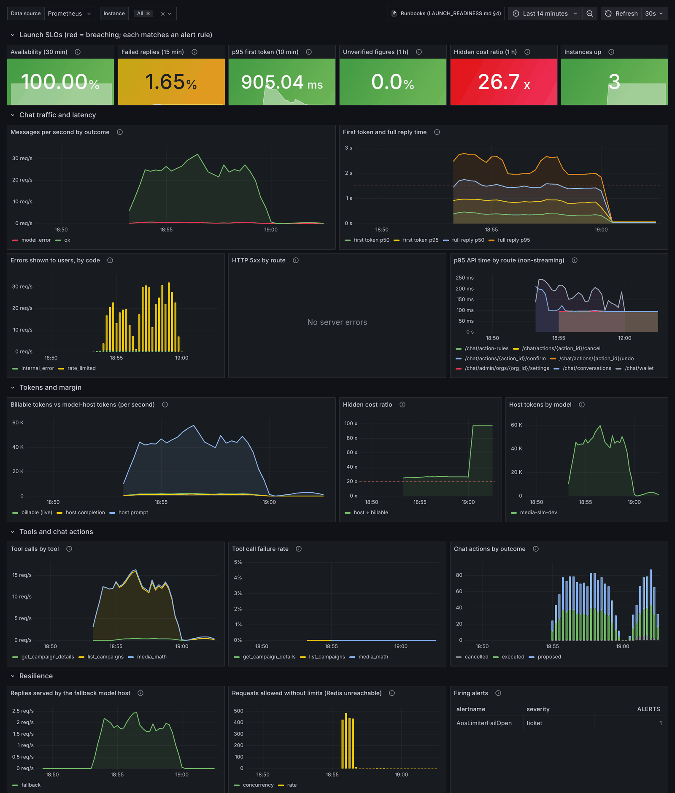

# Launch Readiness (Phase 12)

Status as of 2026-11-22. ✅ = done and verified · 🟡 = built, needs a real environment or a person · ❌ = not started.

## 1. Phase 12 checklist

| Item | Status | Evidence |
|---|---|---|
| **Production safety guard**: the service refuses to start with dev login, mock product, dev payments, default webhook secret, no billing tokenizer, no encryption key, no Redis, no CORS allow-list, no metrics token, or the local database | ✅ | `config.production_problems`, tests in `tests/test_hardening.py`. A fully configured deployment now starts with `CHAT_PAYMENT_PROVIDER=manual`; no online payment provider is needed |
| Security headers, request IDs, 413 for oversized requests, CORS allow-list, API docs off in production | ✅ | `chat_service/api/security.py`, tests |
| Audit log of staff and org-admin changes (who, what, when, request ID); staff-only viewer | ✅ | `chat_audit_log` (migration 0004), `GET /chat/admin/audit` |
| Encryption at rest for stored tool results (client campaign data), with key rotation | ✅ | `chat_service/crypto.py`; tests: data unreadable in the DB, rotation, old key retired |
| Shared rate and concurrency limits across instances (Redis), fail-open if Redis is down | ✅ | `chat_service/engine/limits.py`; tests with real Redis and two simulated servers |
| Metrics (`/metrics`, token-protected), readiness (`/readyz`), liveness (`/healthz`) | ✅ | `chat_service/metrics.py`, tests |
| SLO alert rules | ✅ | `ops/prometheus/alerts.yml` (10 rules, every metric name checked against the code) |
| Automated security tests: every route needs login, staff routes refuse org admins, admin routes refuse members, other orgs can't reach any record by ID | ✅ | `tests/test_security.py` (all 56 routes discovered automatically; 52 non-public routes checked for login, 18 staff routes checked against org admins) |
| Dependency vulnerability scans (Python + widget) and secret scanning in CI | ✅ | `.github/workflows/security.yml`; today: **0 known vulnerabilities** in both |
| Load test at 3× assumed pilot peak, 2 instances | ✅ | §3 |
| Failure drill (model errors + Redis outage under load) | ✅ | §3, including one finding fixed |
| Container image and local full stack | ✅ | `.github/workflows/container.yml` on every relevant push. It builds the image, checks it runs as non-root and refuses an unsafe production config, starts the whole compose stack with monitoring, and runs `ops/smoke_stack.py` (API, a streamed chat message, metrics summed across the 4 workers, Prometheus with the alert rules, Grafana with the dashboard). It also scans the image: 0 fixable critical vulnerabilities. The first runs found and fixed two bugs: per-worker metrics, and a model host unreachable inside compose |
| **External penetration test** | 🟡 | Scope in §5. Needs a vendor (book for weeks 9–10) |
| **Manual billing** (launch without an online payment provider) | ✅ | Pack orders show payment instructions and a reference. Staff confirm the order when the money arrives, which credits tokens exactly once, and mark invoices paid or overdue. `tests/test_manual_billing.py`; runbook below |
| **One full real billing cycle** with pilot orgs, reconciled with zero discrepancies | 🟡 | Mechanism and reconciliation built and tested; needs real pilot orgs (manual billing is enough) |
| Status page, on-call rotation, alert routing (PagerDuty/Opsgenie) | 🟡 | Rules and runbooks ready; tooling and people to assign |
| Dashboard | ✅ | `ops/grafana/` (Grafana, provisioned), §2. Every query run against live data from a load run with injected failures |
| Go/no-go meeting | ❌ | `docs/business/GOVERNANCE_AND_PRICING.md` §2 (decision D12) |

## 2. SLOs and what to watch

| SLO / signal | Target | Metric | Alert |
|---|---|---|---|
| API availability | ≥ 99.5% (30 days) | `aos_http_requests_total` 5xx ratio | `AosAvailabilityBudgetBurn` (page) |
| Reply failures (not charged) | < 2% | `aos_chat_messages_total{status=~"model_error\|internal_error"}` | `AosChatReplyErrors` (page) |
| p95 time to first token | < 1.5 s | `aos_chat_time_to_first_token_seconds` | `AosTimeToFirstTokenSlow` |
| Confirmed actions failing | ≤ 3 per 30 min | `aos_chat_actions_total{outcome="failed"}` | `AosActionFailures` (page) |
| Answers with unverifiable figures | < 5% | `aos_chat_ungrounded_answers_total` | `AosUngroundedAnswersHigh` |
| Hidden cost per message (margin) | uncached overhead ratio ≤ 20× (about 3× expected) | (host − cached) ÷ billable tokens | `AosOverheadRatioHigh` |
| Prompt cache working | cache hit ≥ 50% (about 90% expected) | `aos_chat_host_cached_prompt_tokens_total` ÷ host prompt tokens | `AosPromptCacheHitLow` |
| Fallback model host in use | ~0 | `aos_model_fallback_total` | `AosModelFallbackActive` |
| Redis (limits) reachable | always | `aos_limiter_fail_open_total` | `AosLimiterFailOpen` |

### Dashboard
**AgencyOS Assistant** in Grafana (`ops/grafana/`): 21 panels in 5 sections, with an instance picker and a link to the runbooks.
- **Launch SLOs:** availability, failed replies, p95 first token, unverified figures, hidden cost ratio, instances up. Each turns red at its alert threshold.
- **Chat traffic and latency:** messages/s by outcome · first token and full reply p50/p95 with the 1.5 s SLO line · errors shown to users by code · HTTP 5xx by route · p95 API time by route.
- **Tokens and margin:** billable vs model-host tokens (cached part shown) · hidden cost ratio, all and uncached, with the 20× line · prompt cache hit rate · host tokens by model (canary split).
- **Tools and chat actions:** calls by tool · failure rate by tool · actions by outcome (proposed, executed, cancelled, rejected, rejected_by_approver, expired, failed).
- **Resilience:** fallback host use · requests let through while Redis was down · firing alerts.

Setup:
- Panels are generated by `ops/grafana/build_dashboard.py`.
- `tests/test_dashboard.py` fails if a query or alert uses a metric or label the service doesn't export, or if the JSON is out of date.
- Provisioning is in `ops/grafana/provisioning`.
- Locally: `docker compose --profile monitoring up`.
- After deploying, `python ops/grafana/check_queries.py --prometheus <url>` runs every panel query and lists the ones without data.

**Verified 2026-11-22** in this environment (Prometheus 2.45, Grafana 11.3):
- **Setup:**
  - 2 API instances, primary model host failing 5%, fallback host failing 20%, plus a third instance running chat actions (propose → confirm → undo, or cancel).
  - 6 minutes, 75 virtual users, Redis stopped for 15 s.
  - Rate limit left at the production default of 20 messages per user per minute.
- **Results:**
  - All 25 queries ran without errors, and all 20 panels rendered with no errors.
  - Panels that are empty when healthy (5xx, fallback, fail-open, actions) say so instead of "No data".
  - The dashboard showed the fallback host taking over (~2 replies/s) and the Redis outage (~480 requests let through, then `AosLimiterFailOpen` firing).
  - The users the load-test bots simulate send messages with no pause, so the rate limit refused 7,025 of their 16,165 messages, as designed.
  - Failed replies were 1.7% of the rest, under the 2% SLO, and were never charged: the money checks show 8,985 charged messages = 8,985 successes, 640,181 tokens charged = 640,181 debited, and no reservations left.

**Finding: hidden cost ratio about 26×, above the 20× alert line. Fixed 2026-11-23** (details in [ops/MODEL_HOST.md](../ops/MODEL_HOST.md)).
- **Cause:** each answered message made the model host compute about 1,830 tokens for 71 billable ones. The system prompt and tool schemas are resent on every model call, and the old prompt put the date, user name and role at the top, so no two users shared a cacheable prefix.
- **Fix:**
  1. **Prefix caching** on the model host (vLLM `--enable-prefix-caching --enable-prompt-tokens-details`, or a managed host's prompt caching).
  2. **Cache-friendly prompt** (`system_v3`): a static system prompt and tool schemas, with the context moved to a `[Context]` line on the latest message.
  3. **Shorter prefix**, measured with a Qwen tokenizer: read-only 1,634 → **1,355 tokens** (−17%), with actions 2,156 → **1,731** (−20%). The cache figures below were measured with the first v3 draft, about 50 tokens shorter. Tool schemas no longer carry validation-only keywords, which the server still enforces.
  4. **Cached tokens tracked**: stored per message (migration 0005), exported as `aos_chat_host_cached_prompt_tokens_total`, priced separately (`CHAT_HOST_PRICE_CACHED_INPUT_PER_1M_MINOR`).
  5. **Margin alert** now follows the **uncached** ratio, plus a new `AosPromptCacheHitLow` alert. The dashboard shows the cache hit rate.
- **Result:** uncached host tokens per billable token went from about **26× to about 3×**. Simulation of a 2,000-user day: 2.8–3.0×, cache hit about 91%. Load test: 2.3×, hit 94%. With caching but the old layout it would have been 7–8×.
- **Real-model check of the new prompt:** small open models on CPU, 32-case eval. On Qwen2.5-3B the shipped v3 scored 75% against 72–78% for the old prompt (parity). On 1.5B it scored 62% against 53–56%. One known issue to check on the production model: occasional over-refusal on ad copy and how-to questions. Details and caveats: [docs/chat/PROMPT_V3_LOCAL_EVAL.md](chat/PROMPT_V3_LOCAL_EVAL.md).
- **Still to do:** re-measure with the real model host and tokenizer in staging. Run the eval gate against the chosen production model, Qwen2.5-7B-Instruct on Together AI: add the three `EVAL_MODEL_*` secrets, then Actions → eval → Run workflow ([ops/MODEL_HOST.md](../ops/MODEL_HOST.md#chosen-host-together-ai)). Watch m04 and r13. The 20× alert stays as the safety line on the uncached ratio.

## 3. Load test and failure drill (2026-11-22, this environment)

Setup: 2 API instances sharing Postgres 16 and Redis; stand-in model host (`ops/fake_model_host.py`) with 150 ms to first token, 20 chunks × 25 ms, a read-tool call on 50% of messages. 25 orgs × 3 users = **75 virtual users**, i.e. up to 75 concurrent replies, 3× an assumed pilot peak of ~20–25. `ops/loadtest.py`, then the money checks in `ops/verify_after_load.py`.

| Run | Messages | Throughput | Success | p95 first token | p95 full reply | Money checks |
|---|---|---|---|---|---|---|
| Baseline, 60 s | 2,085 | 33 msg/s | **99.95%** (1 client connection drop, not charged) | **977 ms** | 2.1 s | ✅ all 25 wallets balanced; 0 reservations left; 148,426 tokens debited = 148,426 charged; 2,084 charges = 2,084 successes |
| Drill: 5% model-host failures + Redis stopped for 10 s | 1,242 | 33 msg/s | 92.6% (82 failed replies, as injected) | 1.2 s | 2.3 s | ✅ **none of the 82 failures charged**; wallets balanced; 0 reservations left |
| Drill, after the fix below | 1,217 | 33 msg/s | 93.6% | 1.4 s | 2.8 s | ✅ same |

**What these numbers mean, and don't:** the stand-in model is fast and cheap, so they measure *our* service (gates, wallet, database, streaming, limits), not a real model. Re-run `ops/loadtest.py` in staging against the chosen model host to measure real latency and to size GPUs.

**Finding fixed:** in the first drill, Redis restarted from an old snapshot and brought back stale concurrency slots, so a few users were briefly told "too many replies in progress". Fix: the limits Redis must run **without persistence** (set in `docker-compose.yml`), and slot leases were shortened to 3 minutes. A later run still showed 4 brief refusals once; they weren't reproducible with logging on. Refusals are always uncharged, and log lines now name the limit that refused, for staging follow-up.

## 4. Runbooks

**API errors / instance down.** Check `/readyz` on each instance (database and Redis status) and the logs for the request ID in the `X-Request-ID` header. If the database is down, the service returns 503 from `/readyz` and the load balancer stops routing. Restart unhealthy instances. If errors started after a deploy, roll back the image.

**Model host failing or slow.** Replies that fail are never charged. Check the host's status, then `aos_model_fallback_total`: the fallback host takes over automatically if configured. If both fail: `CHAT_ENABLED_GLOBAL=false`, post on the status page, and re-enable when recovered. If a new model version is involved: `POST /chat/admin/model-rollout/rollback`.

**Slow first token.** Compare TTFT by model (canary vs production), host queue time, and tool latency (`aos_chat_tool_calls_total` plus product API latency). Mitigations: scale model replicas, lower `CHAT_MAX_OUTPUT_TOKENS`, pause a canary.

**Redis unreachable.** Chat keeps working (limits fail open; billing is unaffected because the wallet is atomic in Postgres). Restore Redis **without persistence**. If it was restored from a snapshot, delete the `aos:streams:*` keys.

**Confirmed actions failing.** Turn chat actions off at once: `CHAT_WRITE_ACTIONS_ENABLED_GLOBAL=false` (chat stays read-only). Inspect `GET /chat/admin/actions/pending-approval` and the `chat_actions` rows (status `failed`, `error`). Failed actions are never retried automatically. Contact affected clients and verify each item in the product. Treat it as Sev 1 if a change executed differently from what was displayed.

**Unverifiable figures rising.** Open `GET /chat/admin/quality-review`, check the flagged answers' tool data, and compare by model and prompt version. Roll back a canary or prompt change if one is involved. Add failing cases to `evals/chat_eval_cases.json`.

**Overhead ratio too high, or prompt cache hit low.**
1. Check the "Prompt cache hit rate" panel. If it dropped:
   - Is caching on and reported (`--enable-prefix-caching --enable-prompt-tokens-details`)?
   - Did a deploy change the prompt or tools so it varies per user? `tests/test_prompt_cache.py` should have caught that.
   - Did replicas scale out without prefix-aware routing?
2. If the hit rate is fine, check `GET /chat/admin/economics` by org (long conversations, heavy tool results).
3. Levers: lower `CHAT_TOOL_RESULT_MAX_CHARS` or `CHAT_HISTORY_TURNS`, a shorter prompt, or the fine-tuned model with `system_ft_v2` (Phase 11). See [ops/MODEL_HOST.md](../ops/MODEL_HOST.md).

**Manual billing (finance, staff role):**
- Pending token orders: `GET /chat/admin/payments`. The client sees the reference, e.g. `AOS-1A2B3C4D5E`, and quotes it on the bank transfer.
- Money arrived: `POST /chat/admin/payments/{reference}/confirm` with `{"note": "bank ref"}`. Tokens are credited once, even if confirmed twice. Order won't be paid: `POST /chat/admin/payments/{reference}/cancel`.
- Subscription invoices: approve (`POST /chat/admin/invoices/{id}/approve`), then send it from the accounting system. When it's paid: `POST /chat/admin/invoices/{id}/mark-paid`, which also lifts past-due or suspended status. If it's overdue: `POST /chat/admin/invoices/{id}/mark-unpaid`; the org goes past due and is suspended after `CHAT_DUNNING_GRACE_DAYS` unless paid.
- Every one of these is in the audit log (`GET /chat/admin/audit`).

**Other routine operations** (also in `docs/business/SUPPORT_PILOT_LAUNCH_KIT.md`): goodwill credit, disabling chat for one org, pinning an org to a model, invoice approval, key rotation (`python -m chat_service.crypto rotate`).

**Game day (before go-live, then quarterly):**
1. Start the stand-in host with `--fail-rate 0.05` and `--stall-ms 2000`.
2. Run `ops/loadtest.py` and stop Redis partway through.
3. Trigger the kill switches.
4. Confirm the alerts fire and the runbooks work.
5. Confirm `ops/verify_after_load.py` passes.

## 5. External penetration test: scope to hand the vendor
- **Authentication and tenant isolation** on every `/chat/*` route (our automated suite covers the known paths; ask them to try beyond it).
- **Chat actions:** can a prompt, a tool result, a pasted document or an ad-platform field cause a change without a human confirmation? Can confirmation be replayed or forged across users or orgs?
- **Billing:** can tokens be consumed without being charged, or charged twice, through concurrency, disconnects or webhook replay? Can a forged webhook credit tokens?
- **Streaming endpoint** abuse (slowloris, huge messages, many parallel streams), plus the rate and concurrency limits.
- **Widget:** XSS through model output (markdown), link handling, clickjacking.
- **Staff endpoints:** privilege escalation from org admin.
- **Data at rest:** encrypted tool results; key handling.

## 6. Deployment topology (recommended)
Load balancer (TLS, `/readyz` health check, idle timeout above the longest reply, no response buffering on the stream route) → **2+ API containers** (4 workers each; the image sets `PROMETHEUS_MULTIPROC_DIR` so `/metrics` sums all workers. Set it yourself if you run uvicorn with `--workers` outside the image) → Postgres (managed, point-in-time recovery, daily backup restore test) · Redis (managed or container, **no persistence**) · 1 **jobs** container (`python -m chat_service.jobs`, single replica) · model host (managed or vLLM, **prefix caching on**, see `ops/MODEL_HOST.md`) + fallback host · Prometheus + alerting. Secrets (DB URL, model and payment keys, webhook secret, encryption keys, metrics token) come from the secrets manager.

## 7. What still needs people before launch
1. Optional: an online payment provider (D9). Launch runs on manual billing; Stripe or Razorpay can be added later behind the same interface.
2. Pen-test vendor booked; findings fixed.
3. On-call rotation, alert routing, status page. Point the dashboard at the production Prometheus.
4. Staging environment with the real product API and model host; load test and `ops/smoke_stack.py` re-run there (the container build is verified in CI).
5. One full real billing cycle with pilot orgs, reconciled.
6. Go/no-go meeting (all owners in the RACI).
